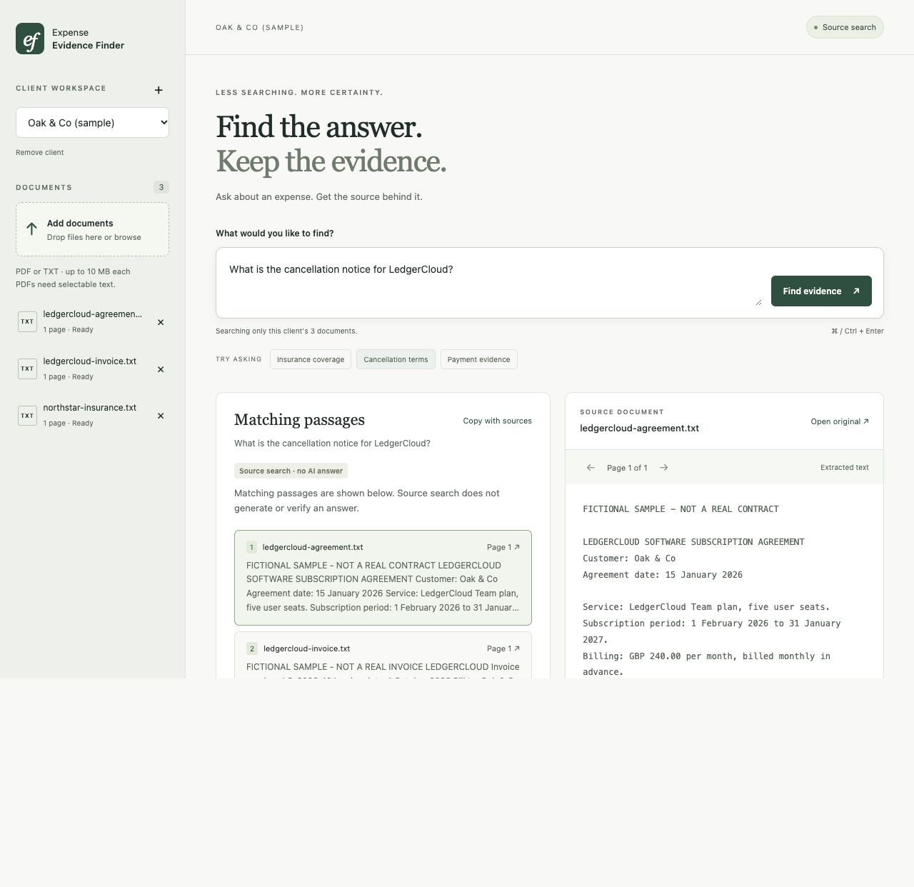

# AI Expense Evidence Finder

A small app for one accounting task: **find the evidence behind an expense question**.

Upload a client's invoices and supplier contracts, ask a question, and inspect the original source. AI answers include page references and quotes checked against the retrieved text.

Built as a personal project you can understand and extend: **FastAPI + SQLite + plain HTML, CSS and JavaScript**.



## Run locally

Requires **Python 3.10+**; developed and tested with Python 3.12.

```sh
git clone <your-repository-url>
cd AI-expense-evidence-finder
python3 -m venv .venv
source .venv/bin/activate
python -m pip install -r requirements.txt
python -m uvicorn app.main:app --host 127.0.0.1 --port 8000 --reload
```

On Windows, activate with `.venv\Scripts\activate` instead. Open **http://127.0.0.1:8000** and click **Try sample documents**. The three sample files are fictional and safe to experiment with.

No API key is needed to try local document upload, keyword search, source viewing, and deletion. Source-search mode shows matching passages; it does **not** generate AI answers or perform semantic search.

### Enable AI answers

```sh
cp .env.example .env
```

Set `OPENAI_API_KEY` in `.env` and restart the server. A funded API account is required. Never put the key in frontend code or commit `.env`.

```dotenv
OPENAI_API_KEY=your-key-here
OPENAI_CHAT_MODEL=gpt-4.1-mini
OPENAI_EMBEDDING_MODEL=text-embedding-3-small
DATA_DIR=./data
```

The first question indexes that client's documents with embeddings. Later questions reuse them. New documents and changes to `OPENAI_EMBEDDING_MODEL` are indexed automatically on the next question. Model names are configurable; the chat model must support the Responses API with structured outputs.

Example questions for the sample workspace:

- What period does the Northstar insurance invoice cover?
- What is the cancellation notice for LedgerCloud?
- What service period is stated on invoice LC-2026-10?
- Has the Northstar insurance invoice been paid? *(The samples do not establish payment; an AI answer should report insufficient evidence.)*

## What it does

- Create separate client workspaces.
- Upload PDFs with a text layer or UTF-8 text files, individually or together.
- Search within the selected client only.
- Generate short answers with cited evidence when an API key is configured.
- Show source excerpts, extracted pages, and a link to the original file.
- Copy findings together with their source references.
- Report insufficient or conflicting evidence.
- Remove documents or entire workspaces, including their extracted pages and embeddings.

## How the RAG pipeline works

```text
PDF / TXT upload
    → page-aware text extraction
    → overlapping chunks (kept within each page)
    → SQLite: original file + pages + chunks

Question + selected client
    → create / reuse document embeddings
    → keyword ranking (BM25) + embedding similarity (cosine)
    → combine rankings with reciprocal rank fusion
    → six relevant passages + question → language model
    → structured claims and exact source quotes
    → validate source IDs and quote text
    → show finding and source pages
```

The model cannot supply source URLs or arbitrary document IDs. The app constructs source references from the retrieved chunks. If any claim lacks a citation, references an unknown chunk, or quotes text that is absent from its source, the entire answer is withheld. Whitespace differences from PDF extraction are tolerated.

**Quote validation verifies provenance, not factual correctness or logical support.** A model can still misinterpret a real quote. Always review the original page. Retrieval is limited to the top passages, so the app cannot prove that evidence is absent from the whole corpus or discover every contradiction.

SQLite stores embeddings as JSON. Similarities are calculated in Python over a bounded client index. This deliberately trades large-scale performance for a small, understandable implementation. A vector database can be added later without changing the UI.

## Project layout

```text
app/
  main.py          HTTP endpoints, client/document management
  config.py        Environment settings and limits
  database.py      SQLite schema and connections
  ingestion.py     PDF/text extraction and page-aware chunking
  rag.py           Retrieval, rank fusion, citation validation
  provider.py      OpenAI embeddings and structured answers
  static/
    index.html     Single-page interface
    styles.css     Responsive styling
    app.js         UI interactions
    examples/      Three fictional documents
tests/             API, retrieval and provider-contract tests
.github/workflows/ Automated checks for GitHub
```

The machine-readable API schema is at **http://127.0.0.1:8000/openapi.json**. Each question is independent; there is no conversation memory or saved answer history.

## Data and boundaries

This is a **local, single-user project**, not a production service. Client folders are a search boundary, not an authentication or tenant-security system. Anyone with access to the running app can access its workspaces. It binds to localhost, rejects unexpected hostnames and cross-origin browser writes, and has no login.

- Original files, text and embeddings are stored in `data/evidence.sqlite3`, which is ignored by Git.
- In source-search mode, document processing and queries stay local.
- In AI mode, extracted document chunks are sent to OpenAI for embeddings; questions and retrieved passages are sent for answer generation. API use incurs charges.
- The Responses API call uses `store=False`. This is not a blanket zero-retention guarantee; check your provider/account's data settings before using sensitive documents.
- Deletion removes records from the live database and retrieval index. It does not securely erase disk pages, backups, clipboard copies, or provider-side records.
- The application does not intentionally log document contents, questions or API keys.
- `.env`, `data/`, virtual environments and caches are excluded from Git.

Do not expose this server publicly without adding authentication, authorisation, request limits, operational monitoring and a deliberate data-storage policy.

## Deliberate MVP limits

- **No OCR.** Scanned PDFs need OCR before upload. A PDF with any empty/unreadable page is rejected rather than silently indexed incompletely; remove genuinely blank pages before uploading.
- **10 MB and 50 pages per PDF**, with a 500,000-character extracted-text limit and a 5,000-chunk index limit per client. Text files are treated as one page.
- PDF text extraction may lose table structure; inspect the original for complex layouts.
- Indexing happens during the first AI question, so it can be slow for a large batch. Provider errors are shown with retry guidance.
- No tax advice, numerical aggregation, journal posting, bank matching, or accounting-system integrations.
- No automatic document-version selection. Remove obsolete versions or review conflicting evidence.

## Development and checks

```sh
python -m pytest
node --check app/static/app.js  # optional syntax check; Node is not needed to run the app
```

Tests run without an API key or network calls. They cover real PDF parsing, upload failures, duplicate files, client scoping, persistence, cascade deletion, embedding-cache reuse, semantic/keyword retrieval, conflicting evidence, citation rejection and the actual OpenAI SDK's request/response contract using a mock HTTP transport.

They do not measure the accuracy of a live model. Before relying on AI output, review a set of representative accounting questions with their expected source passages, including missing evidence, conflicting terms, and uploaded instructions that the model should ignore.

`requirements.txt` pins the versions used for this implementation, including the test tools. `pyproject.toml` declares direct dependency ranges. To intentionally update dependencies in a fresh environment:

```sh
python -m pip install -e '.[dev]'
python -m pytest
python -m pip freeze --exclude-editable > requirements.txt
```

GitHub Actions runs the tests and JavaScript syntax check on pushes and pull requests. To publish, create an empty repository in your GitHub account and follow its existing-project instructions. Review the staged files first; `.env` and `data/` must stay out of the repository.

## Small next steps

1. Add a real-question evaluation set and measure citation support and time saved.
2. Add OCR as an optional ingestion step.
3. Move indexing to a background worker with progress reporting.
4. Add login and permissions only when moving beyond local use.
5. Replace in-memory vector scoring if the collection outgrows this design.

References: [OpenAI embeddings](https://developers.openai.com/api/docs/guides/embeddings), [structured outputs](https://developers.openai.com/api/docs/guides/structured-outputs), [pypdf text extraction](https://pypdf.readthedocs.io/en/stable/user/extract-text.html).
